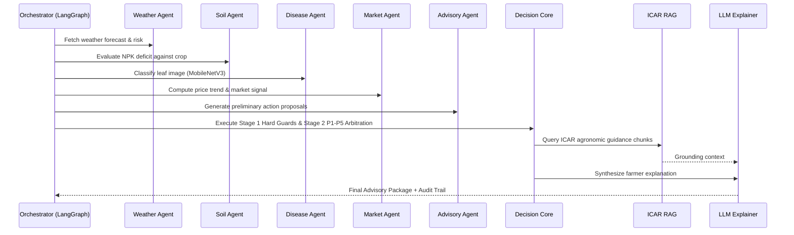

# AgriMind

Observable Multi-Agent Orchestration for Intelligent Crop Advisory

---

## 1. Project Overview

**AgriMind** is an enterprise-grade agricultural advisory platform that integrates multi-agent AI orchestration, deterministic agronomic safety rules, on-device computer vision, institutional RAG grounding, and deep observability. The system empowers smallholder farmers and extension officers with hyper-local, climate-resilient, and scientifically verified agronomic advisories across diverse agro-ecological zones.

AgriMind strictly decouples probabilistic intelligence (LLM explanations and vision inference) from safety-critical decision logic. Regardless of model hallucinations or conflicting agent proposals, high-priority safety guards deterministically protect crops from chemical leaching, improper fertilization, and unverified chemical applications.

---

## 2. Problem Statement

Smallholder farmers encounter severe operational and climatic risks:
- **Erratic Weather:** Sudden heavy rainfall events lead to chemical wash-off and environmental leaching when fertilizers or pesticides are applied right before rain.
- **Crop Disease Misdiagnosis:** Pathogen outbreaks are misidentified or treated with incorrect agrochemical dosages, causing crop failure and economic distress.
- **Soil Depletion:** Imbalanced NPK application leads to soil acidification and degraded yields over successive planting seasons.
- **Market Volatility:** Harvesting and selling decisions are made without localized price momentum intelligence from APMC mandis.
- **Unsafe Generic AI Systems:** Off-the-shelf generative AI models hallucinate untested agrochemical mixtures, lack regulatory grounding, and fail to provide transparent audit trails for their recommendations.

---

## 3. Proposed Solution

AgriMind addresses these systemic risks through a **deterministic safety-first multi-agent orchestration architecture**:
1. **Domain Specialists:** Autonomous, specialized agents asynchronously retrieve satellite weather forecasts, evaluate soil chemistry against crop benchmarks, perform computer vision inference on leaf photographs, and calculate mandi price velocity.
2. **Deterministic Hard Safety Guards (Stage 1):** Non-overridable agronomic gates (e.g., Rainfall Veto, Disease Alert Thresholds) execute before scoring.
3. **P1–P5 Conflict Arbitration & Scoring (Stage 2):** Algorithmic prioritization resolves competing agent goals and computes a calibrated **Decision Stability Score (DSS)**.
4. **Institutional Grounding (RAG):** Verified agronomic guidance from the **2025 ICAR Kharif Agro-Advisories** corpus is retrieved via hybrid TF-IDF and metadata reranking.
5. **Multi-Provider LLM Explainer:** Translates structured recommendations into farmer-friendly explanations with automatic fallback across xAI Grok, Groq Llama, Google Gemini, and offline rule templates.
6. **Relational Observability:** Complete execution traces, latencies, agent state transitions, and farmer adoption feedback are persisted to an audit ledger.

---

## 4. Key Features

- **Rainfall Safety Veto:** Automatically vetoes (`DELAY`) chemical fertilizer application when precipitation probability exceeds 70% or forecasted rainfall exceeds 5.0 mm.
- **Gated Vision Inference:** 38-class MobileNetV3 PyTorch model with a strict 60% confidence gate preventing automated misdiagnosis of healthy or ambiguous leaves.
- **ICAR 2025 Knowledge Retrieval:** 1,219 cleaned advisory chunks extracted from the Indian Council of Agricultural Research (ICAR) Kharif 2025 corpus.
- **P1–P5 Conflict Arbitration Matrix:** Explicit hierarchy where weather safety and acute disease management strictly supersede soil optimization and market timing.
- **Decision Stability Score (DSS):** Normalized stability metric ($0.0$ to $1.0$) with dynamic re-evaluation triggers (`HIGH`, `MODERATE`, `LOW`).
- **Resilient Multi-LLM Router:** Automatic zero-downtime routing across xAI, Groq, Gemini, and deterministic template fallback.
- **Full Traceability & Audit Trail:** Relational schema logging every decision, agent state, conflict occurrence, and farmer feedback.
- **Modern Responsive Dashboard:** Next.js 16 (Turbopack) UI with real-time visual telemetry, step-by-step trace inspection, and interactive audit reports.

---

## 5. System Architecture


---

## 6. Multi-Agent Architecture

AgriMind coordinates domain agents within a LangGraph StateGraph workflow driven by a shared, immutable-state payload (`AdvisoryState`):



---

## 7. Agent Responsibilities

| Agent | Responsibility | Primary Data Source | Fallback Strategy |
| :--- | :--- | :--- | :--- |
| **Weather Agent** | Analyzes precipitation, humidity, temperature, and calculates rainfall spray risk. | Open-Meteo API | Seasonal agro-climatic defaults |
| **Soil Agent** | Assesses Nitrogen, Phosphorus, Potassium (NPK) against crop-specific agronomic benchmarks. | Soil Health Card / Lab Test Input | Regional soil profile baseline |
| **Disease Vision Agent** | Performs computer vision leaf inference, predicts disease class, and assigns severity rating. | PyTorch MobileNetV3 (PlantVillage) | Gated unknown/review state (<60% conf) |
| **Market Agent** | Evaluates mandi modal prices, calculates 7-day price velocity, and suggests market timing. | Agmarknet / eNAM Data Feeds | Neutral market condition profile |
| **Advisory Agent** | Synthesizes heuristics and formulates preliminary recommendations. | Internal agronomic rules | Baseline safe practices |
| **LLM Explainer** | Generates clear, multi-lingual farmer explanations grounded strictly in ICAR evidence. | xAI / Groq / Google Gemini | Offline deterministic template |

---

## 8. Data Flow

1. **Ingestion:** Farmer inputs location (or coordinates), target crop, planting stage, soil NPK values, and optional leaf photograph.
2. **Concurrent Agent Execution:** Specialist agents run domain logic, generating structured evidence payloads.
3. **Stage-1 Hard Safety Screening:**
   - Evaluates Hard Guards A through F.
   - If rainfall probability > 70% or precipitation > 5mm, fertilizer application is immediately vetoed (`DELAY`).
4. **Stage-2 Priority Arbitration:**
   - Conflicting goals (e.g. soil demands fertilizer vs. weather vetoes) are arbitrated by the P1–P5 priority matrix.
   - Computes Decision Stability Score (DSS).
5. **Institutional RAG Grounding:**
   - ICAR knowledge retriever matches crop, disease, and recommended action with verified extension handbook guidelines.
6. **LLM Explanation Synthesis:**
   - Synthesizes farmer-facing narrative, citing ICAR guidelines, without altering the chosen action or dosage.
7. **Persistence & Presentation:**
   - Records run trace, agent latencies, conflict resolution events, and recommendation to SQLite/PostgreSQL.
   - Next.js UI displays full advisory card, weather radar, soil gauge, and audit log.

---

## 9. Technology Stack

- **Frontend:** Next.js 16.3.4 (Turbopack), React 19, TypeScript 5.7, Tailwind CSS
- **Backend API:** FastAPI 0.115, Uvicorn 0.34, Pydantic 2.10 (strict `extra="forbid"`)
- **Orchestration:** LangGraph 1.2 StateGraph, Python 3.10+ / 3.14.2
- **Machine Learning & Vision:** PyTorch 2.6, Torchvision 0.21, MobileNetV3-Large, Scikit-learn
- **RAG & Knowledge:** Hybrid TF-IDF vectorizer, 1,219 ICAR Kharif chunks, ChromaDB-compatible interface
- **Database & Observability:** SQLite 3 (`agrimind_local.db`) / PostgreSQL (Supabase), SQLAlchemy 2.0
- **External Services:** Open-Meteo Weather API, Open-Meteo Geocoding API, Agmarknet Mandi API
- **Testing:** Pytest 9.1 (130 automated tests passing), HTTPX

---

## 10. Disease Detection

AgriMind features an on-device computer vision pipeline based on **MobileNetV3-Large**:
- **Dataset:** 38 crop disease classes covering tomato, potato, corn, apple, grape, pepper, and more from the PlantVillage dataset.
- **Model Architecture:** MobileNetV3-Large fine-tuned with class-weighted cross-entropy loss and cosine annealing learning rate scheduling.
- **Confidence Gate:** Inferences with `< 60%` confidence are marked `non-actionable` (`requires_expert_confirmation: true`), preventing incorrect chemical treatments.
- **Severity Rating:** Classifies detected pathology into `CRITICAL`, `HIGH`, `MODERATE`, `LOW`, or `NONE` (healthy tissue), dynamically driving the P1–P5 priority matrix.

---

## 11. Weather Analysis

The Weather Agent integrates with Open-Meteo's high-resolution forecast models:
- **Metrics Tracked:** 24h & 7-day rainfall accumulation, precipitation probability (%), relative humidity, temperature, wind speed.
- **Rainfall Risk Index ($R_w$):** Scaled from 0.0 to 1.0 based on rainfall probability and volume.
- **Safety Veto Trigger:** When $R_w > 0.70$ or precipitation forecast exceeds 5 mm within a 24-hour window:
  - Fertilizer application action is vetoed to `DELAY`.
  - Chemical foliar spray is vetoed to prevent runoff into groundwater.

---

## 12. Soil Analysis

The Soil Agent analyzes lab-tested or estimated soil chemistry:
- **Macronutrient Tracking:** Nitrogen (N), Phosphorus (P), Potassium (K) measured in kg/ha or ppm.
- **Crop-Specific Benchmarks:** Compares soil readings against baseline requirements for wheat, rice, maize, cotton, sugarcane, and pulses.
- **Deficiency Scoring:** Calculates normalized deficiency scores ($S_d$) for each nutrient.
- **Organic Amendment Integration:** Recommends Farmyard Manure (FYM) or bio-fertilizers when organic matter deficit is detected.

---

## 13. Market Intelligence

The Market Agent evaluates economic trade-offs using mandi market feeds:
- **Price Trend Analysis:** 7-day and 30-day price momentum calculation across regional APMC mandis.
- **Harvest Timing Optimization:** Identifies price surges and recommends expedited harvest or delayed release into local storage.
- **Economic Tie-Breaking:** Market signals act strictly as economic tie-breakers; they are programmatically barred from overriding agronomic safety guards or disease interventions.

---

## 14. Advisory & Fertilizer Recommendation

The Decision Engine combines domain inputs to produce unambiguous actions:
- **Action Taxonomy:**
  - `APPLY_FERTILIZER`: Nutrient supplementation safe and required.
  - `DELAY`: Postpone operation due to imminent rainfall or wet soil conditions.
  - `APPLY_TREATMENT`: High-confidence therapeutic intervention for identified pathogen.
  - `MONITOR`: Low-severity observation; no chemical intervention required.
  - `SEEK_EXPERT_CONFIRMATION`: Ambiguous visual symptoms requiring human agronomist review.
- **Dosage Guidance:** Exact NPK formulations (e.g., Urea, DAP, MOP) calculated according to ICAR package of practices.

---

## 15. Explainability

AgriMind provides farmer-centric explanations through a multi-provider LLM explainer:
- **Zero-Downtime Router:** Attempts providers in configurable priority: `xAI Grok` $\rightarrow$ `Groq Llama-3.3-70b` $\rightarrow$ `Google Gemini-2.5-Flash` $\rightarrow$ `Deterministic Rule Template`.
- **Strict Guardrail:** LLMs cannot change the chosen action, dosage, or safety guards; their role is strictly explanatory.
- **ICAR Evidence Citations:** Explanations cite specific handbook guidelines and official advisory recommendations.

---

## 16. Observability

Full relational observability records every operational cycle:
- **Trace Persistence:** Every request is assigned a unique UUID `run_id`.
- **Latency Accounting:** Records execution duration for each agent, the decision engine, RAG retrieval, and LLM explanation.
- **Conflict Logging:** Explicitly logs every detected conflict, participating agents, and the winning priority rule.
- **Farmer Feedback Loop:** Captures farmer adoption (`accepted`, `rejected`, `modified`) and field outcomes to support continuous improvement.

---

## 17. Evidence & Audit Trail

Every advisory generated by AgriMind is accompanied by a tamper-evident audit trail:
- **Structured Evidence Payload:** Exact numeric values from weather forecasts, soil tests, vision confidence scores, and market indices.
- **Decision Stability Score (DSS):** Quantifies confidence in the recommendation stability against dynamic environmental changes.
- **Rule Citation:** Explicitly lists the rule code (e.g., `GUARD_A_RAINFALL_VETO`, `P2_ACUTE_DISEASE_OVERRIDE`) that determined the outcome.
- **Institutional References:** Direct chunk IDs and titles from the official ICAR Kharif 2025 corpus.

---

## 18. Installation

### Prerequisites
- Python 3.10+ (tested on Python 3.10 through 3.14)
- Node.js 18+ and npm 9+
- Git

### Setup Instructions

```bash
# 1. Clone repository
git clone https://github.com/Lokilogesh001/agrimind.git
cd agrimind

# 2. Setup environment configuration
cp .env.example .env

# 3. Install Python dependencies
pip install -r requirements.txt

# 4. Install Frontend dependencies
npm install
```

---

## 19. Environment Variables

Create your local `.env` configuration file from the safe `.env.example` template:

```bash
cp .env.example .env
```

| Variable | Default Value | Description |
| :--- | :--- | :--- |
| `DATABASE_URL` | `sqlite:///agrimind_local.db` | SQLAlchemy database connection string (SQLite local or PostgreSQL). |
| `OPEN_METEO_BASE_URL` | `https://api.open-meteo.com/v1/forecast` | Open-Meteo weather endpoint (no API key required). |
| `GEOCODING_BASE_URL` | `https://geocoding-api.open-meteo.com/v1/search` | Open-Meteo geocoding service (no key required). |
| `AGMARKNET_BASE_URL` | *(empty)* | Optional endpoint for live APMC mandi price feeds. |
| `DISEASE_MODEL_PATH` | `ml/artifacts/best.pt` | Path to trained MobileNetV3-Large PyTorch weights (38 classes). |
| `CORS_ORIGINS` | `http://localhost:3000,http://127.0.0.1:3000` | Allowed CORS origins for API gateway. |
| `NEXT_PUBLIC_API_URL` | `http://localhost:8000` | Target backend URL used by the Next.js frontend. |
| `LLM_PRIMARY_PROVIDER`| `openai` | Primary explanation provider (`openai`, `grok`, or `deterministic`). |
| `LLM_FALLBACK_PROVIDER`| `grok` | Fallback explanation provider. |
| `LLM_TEMPLATE_FALLBACK`| `true` | Offline deterministic template fallback when external LLMs are unconfigured. |
| `OPENAI_API_KEY` | *(empty)* | Optional OpenAI API key (explanations only; decisions remain deterministic). |
| `XAI_API_KEY` | *(empty)* | Optional xAI Grok API key for explanation fallback. |

> **Note:** External LLM API keys are completely optional. In their absence, AgriMind engages its built-in rule template explainer with zero downtime.

---

## 20. Running the Project

### One-Command Unified Launcher (Windows)
Run the automated launcher script (starts backend, frontend, verifies ports, and terminates cleanly on Ctrl+C):

```powershell
.\start.ps1
```

### Cross-Platform Unified Launcher (Node.js)
Start both backend and frontend concurrently:

```bash
npm run dev
```

### Manual Individual Startup

**Backend API Gateway:**
```bash
python -m uvicorn api.main:app --host 127.0.0.1 --port 8000 --reload
```

**Next.js Frontend:**
```bash
cd web
npm run dev
```

### Active Endpoints:
- **Web UI:** [http://localhost:3000](http://localhost:3000)
- **FastAPI Gateway:** [http://127.0.0.1:8000](http://127.0.0.1:8000)
- **Interactive Swagger Docs:** [http://127.0.0.1:8000/docs](http://127.0.0.1:8000/docs)
- **API Health Check:** [http://127.0.0.1:8000/health](http://127.0.0.1:8000/health)

### Running Automated Verification & Evaluation:
```bash
# 1. Run 8-tier production operational verification
npm test
# or: python scripts/verify_product.py

# 2. Run complete pytest regression suite (126 tests)
pytest tests/ -v

# 3. Run master scientific evaluation suite (PlantDoc disease benchmark + 16 ICAR scenarios + 18 data quality probes)
npm run evaluate
# or: python scripts/run_evaluation.py
```

---

## 21. Project Structure

```
agrimind/
├── .env.example                     # Environment template without secrets
├── .gitignore                       # Git exclusions (caches, logs, models, secrets)
├── Dockerfile                       # Container deployment definition
├── docker-compose.yml               # Multi-service container orchestration
├── main.py                          # CLI runner for end-to-end evaluation
├── package.json                     # Unified dev scripts launcher
├── requirements.txt                 # Backend Python dependencies
├── start.ps1                        # Cross-process PowerShell manager
│
├── agents/                          # Specialist Domain Agents
│   ├── advisory_agent.py            # Preliminary heuristic advisory generator
│   ├── disease_agent.py             # MobileNetV3 vision inference agent
│   ├── market_agent.py              # Agmarknet mandi price momentum agent
│   ├── soil_agent.py                # Soil NPK deficit evaluation agent
│   └── weather_agent.py             # Open-Meteo forecast and spray risk agent
│
├── api/                             # FastAPI Gateway
│   └── main.py                      # REST endpoints (/advisory, /runs, /health)
│
├── data_sources/                    # External Data Connectors
│   ├── geocoding.py                 # Open-Meteo geocoding connector
│   ├── market.py                    # Agmarknet price feed scraper/mock
│   ├── soil.py                      # Crop NPK benchmark database
│   └── weather.py                   # Open-Meteo client
│
├── decision/                        # Deterministic Decision Core
│   ├── models.py                    # Pydantic data schemas for decisions & rules
│   ├── rules.py                     # Hard safety guards (A-F) & P1-P5 resolver
│   └── scoring.py                   # Decision Stability Score (DSS) calculator
│
├── docs/                            # In-depth Technical Documentation Suite
│   ├── ARCHITECTURE.md              # Detailed subsystem architecture
│   ├── AGENTS.md                    # Agent specifications and metrics
│   ├── AI_ORCHESTRATION.md          # StateGraph and conflict arbitration
│   ├── API_DOCUMENTATION.md         # API schema and endpoints guide
│   ├── CONFIGURATION.md             # Environment and security configuration
│   ├── DATABASE.md                  # Relational schema and queries
│   ├── DEPLOYMENT.md                # Docker and cloud deployment
│   ├── INSTALLATION.md              # Prerequisites and setup guide
│   ├── OBSERVABILITY.md             # Traceability, latency, and feedback
│   ├── PROJECT_OVERVIEW.md          # Motivation and problem statement
│   ├── PROJECT_STRUCTURE.md         # Comprehensive file tree breakdown
│   ├── SYSTEM_WORKFLOW.md           # Sequence diagrams and state machine
│   ├── TESTING.md                   # Test suite catalog and coverage
│   └── TROUBLESHOOTING.md           # FAQ and error recovery
│
├── evaluation/                      # Evaluation & benchmarking datasets
├── knowledge/                       # Institutional Knowledge Corpus
│   ├── ICAR-En-Kharif-...2025.pdf   # Official ICAR handbook reference
│   └── icar_chunks.json             # 1,219 cleaned ICAR RAG knowledge chunks
│
├── llm/                             # LLM Explanation Layer
│   └── explainer.py                 # Multi-provider router with template fallback
│
├── ml/                              # Machine Learning Vision Pipeline
│   ├── disease_model.py             # PyTorch MobileNetV3 model architecture
│   ├── plantvillage_dataset.py      # Dataset loading and augmentation
│   └── train_disease.py             # Training loop with AMP and early stopping
│
├── observability/                   # Observability & Audit Trail Engine
│   ├── database.py                  # SQLAlchemy models and trace repository
│   └── schema.sql                   # Relational database table definitions
│
├── orchestrator/                    # LangGraph StateGraph Engine
│   ├── graph.py                     # Workflow execution graph wiring
│   └── state.py                     # AdvisoryState definition and helpers
│
├── rag/                             # Institutional RAG Subsystem
│   ├── icar_ingest.py               # PDF parser and chunk generator
│   ├── metadata.py                  # Metadata schemas and keyword extraction
│   └── retriever.py                 # Hybrid TF-IDF retriever with reranker
│
├── scripts/                         # Operational Scripts
│   ├── setup_runtime.py             # Dataset and model asset downloader
│   └── verify_product.py            # Offline product verification test
│
├── tests/                           # Automated Test Suite (130 tests)
│   ├── test_adaptive_evidence_novelty.py
│   ├── test_api_hardening.py
│   ├── test_graph_wiring.py
│   ├── test_llm_observability.py
│   ├── test_orchestrator.py
│   ├── test_phase2_research_core.py
│   ├── test_rag_quality.py
│   ├── test_refactor.py
│   ├── test_repair_batch.py
│   └── test_v11_hardening.py
│
└── web/                             # Next.js 16 Web Application
    ├── app/
    │   ├── globals.css              # Custom styling
    │   ├── layout.tsx               # Root layout
    │   └── page.tsx                 # Interactive multi-agent dashboard UI
    ├── package.json                 # Web dependencies
    └── tsconfig.json                # TypeScript compiler configuration
```

---

## 22. Team

- **Platform Architecture & Development:** AgriMind Core Engineering Team
- **Agronomic Advisor & Safety Rules:** Indian Council of Agricultural Research (ICAR) Kharif Advisory Alignment
- **Machine Learning & Computer Vision:** MobileNetV3 Agricultural Pathology Research Group

---

## 23. Future Improvements

1. **Satellite Remote Sensing:** Direct integration with Sentinel-2 NDVI imagery for field-scale canopy health monitoring.
2. **Vernacular Voice Agent:** Interactive voice-response (IVR) and conversational audio in regional languages (Hindi, Tamil, Telugu, Marathi).
3. **Hyper-Local IoT Micro-Sensors:** Integration with LoRaWAN soil moisture and EC probes for real-time ground truth calibration.
4. **Offline Mobile Edge Deployment:** ONNX runtime quantization for sub-second offline inference on low-cost Android smartphones.
5. **Dynamic Mandi Transport Optimization:** Fleet route planning to minimize produce spoilage between farm-gate and APMC mandis.

---

## 📄 License & Institutional Credits

- **Corpus:** ICAR Kharif Agro-Advisories for Farmers 2025.
- **Vision Dataset:** Penn State PlantVillage Dataset.
- **Weather Services:** Open-Meteo API.
