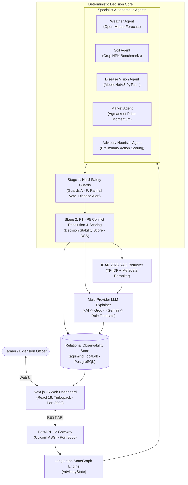

# 🌾 AgriMind

> **Multi-Agent Resilient Agricultural Advisory & Decision Platform**  
> Deterministic agronomic safety, autonomous domain specialists, on-device vision inference, and official ICAR institutional grounding.

---

## 🚀 ONE-Command Startup

Start the complete application (FastAPI backend + Next.js frontend) with a single command from the project root:

```bash
# 1. Install all dependencies (backend + frontend)
npm install

# 2. Launch complete AgriMind platform
npm run dev
```

### Active Services:
- **💻 Web Application:** [http://localhost:3000](http://localhost:3000)
- **📡 REST API Gateway:** [http://127.0.0.1:8000](http://127.0.0.1:8000)
- **📚 Interactive API Docs (Swagger):** [http://127.0.0.1:8000/docs](http://127.0.0.1:8000/docs)

*To stop all services, press `Ctrl+C`. All child processes and ports will be released immediately.*

---

## 📖 Executive Summary & Problem Statement

Smallholder farmers in India face significant challenges from unpredictable monsoon patterns, emerging crop diseases, soil nutrient exhaustion, and volatile mandi market prices. Conventional approaches either rely on static advice charts or generic LLMs that hallucinate untested agrochemicals and fail to recognize critical meteorological safety hazards.

**AgriMind** bridges this gap by decoupling evidence gathering from safety-critical decision logic:
1. **Specialist Domain Agents** gather signals from satellite meteorology, soil chemistry, computer vision, and mandi feeds.
2. **Deterministic Decision Core** enforces non-overridable safety guards (e.g. Rainfall Safety Vetoes) and arbitrates trade-offs using a prioritized P1–P5 conflict hierarchy.
3. **Institutional Grounding (RAG)** retrieves verified agronomic guidance from the official **2025 ICAR Kharif Agro-Advisories** corpus.
4. **LLM Explainer Layer** translates the deterministic recommendation into clear, actionable advice across multiple providers (xAI Grok, Groq Llama, Google Gemini) with a built-in offline rule template fallback.

---

## 🏗️ System Architecture



---

## ⚡ Key Features

- **🛡️ Deterministic Safety Core:** Enforces Hard Safety Guards (A–F). When predicted precipitation exceeds 70% or 5mm, chemical fertilizer application is vetoed (`DELAY`) to prevent leaching and economic waste.
- **👁️ On-Device Disease Vision:** Custom PyTorch MobileNetV3 model trained on 38 plant disease classes with a 60% confidence gate preventing automated misdiagnosis.
- **📚 2025 ICAR Institutional RAG:** 1,219 cleaned advisory chunks extracted from official ICAR Kharif guidance, indexed with hybrid TF-IDF and metadata-aware reranking.
- **📊 Decision Stability Score (DSS):** Computes recommendation resilience ($0.0$ to $1.0$) with corresponding re-evaluation triggers (`HIGH`, `MODERATE`, `LOW`).
- **🔍 Full Traceability & Observability:** Relational ledger recording 9-step execution traces, agent latencies, conflict arbitration logs, and farmer feedback.
- **🌐 Zero-Downtime LLM Router:** Automatic fallback across xAI Grok-4.6, Groq Llama-3.3-70b, Google Gemini-2.5-Flash, and offline deterministic templates.

---

## 💻 Technology Stack

| Layer | Technologies |
| :--- | :--- |
| **Frontend** | Next.js 16.3.4 (Turbopack), React 19, TypeScript 5.7, Tailwind CSS |
| **Backend API** | FastAPI 0.115, Uvicorn 0.34, Pydantic 2.10 (strict `extra="forbid"`) |
| **Orchestration** | LangGraph 1.2 StateGraph, Python 3.10+ / 3.14.2 |
| **Machine Learning** | PyTorch 2.6, Torchvision 0.21, Pillow, Scikit-learn (TF-IDF) |
| **Database** | SQLite (`agrimind_local.db`) / PostgreSQL (Supabase), SQLAlchemy 2.0 |
| **External APIs** | Open-Meteo Weather API, Open-Meteo Geocoding, Agmarknet |
| **Testing** | Pytest 9.1 (130 automated tests passing), HTTPX |

---

## 📋 Available Developer Commands

All core tasks can be run directly from the project root:

```bash
# Development: Start both Backend and Frontend with one command
npm run dev

# Testing: Run full test suite (130 automated tests)
npm test

# Product Testing: Run offline agricultural safety gate checks
npm run test:product

# Typecheck: Run TypeScript compiler check on frontend
npm run lint

# Build: Compile Next.js production bundle
npm run build

# Production: Start production backend and frontend
npm start

# Cleanup: Clean all cache directories, __pycache__, and build artifacts
npm run clean
```

---

## ⚙️ Environment Configuration

Copy the template file to configure your local environment:

```bash
cp .env.example .env
```

### Core Environment Variables:
```ini
# Database & Core
DATABASE_URL=sqlite:///agrimind_local.db
DISEASE_MODEL_PATH=ml/artifacts/best.pt
CORS_ORIGINS=http://localhost:3000,http://127.0.0.1:3000

# Weather API (no key required for standard usage)
OPEN_METEO_BASE_URL=https://api.open-meteo.com/v1/forecast

# Optional LLM Explanation Layer (leave blank for deterministic mode)
XAI_API_KEY=
XAI_MODEL=grok-4.6
GROQ_API_KEY=
GROQ_MODEL=llama-3.3-70b-versatile
GEMINI_API_KEY=
GEMINI_MODEL=gemini-2.5-flash
LLM_PROVIDER_ORDER=xai,groq,gemini
LLM_TIMEOUT_SECONDS=20
LLM_RETRIES=2
```

---

## 📚 Technical Documentation Suite

Comprehensive technical documentation is organized in the [`docs/`](docs/) directory:

- [**Project Overview**](docs/PROJECT_OVERVIEW.md) — Motivation, target personas, functional requirements, and current status.
- [**System Architecture**](docs/ARCHITECTURE.md) — Detailed component design, data flows, and subsystem specifications.
- [**System Workflow**](docs/SYSTEM_WORKFLOW.md) — End-to-end execution sequence, Mermaid flowcharts, and 7-phase processing.
- [**Specialist Agents**](docs/AGENTS.md) — Deep-dive into Weather, Soil, Disease, Market, Advisory, and LLM Explainer agents.
- [**AI Orchestration**](docs/AI_ORCHESTRATION.md) — LangGraph state machine, Stage-1 Safety Guards, P1–P5 conflict resolution, and DSS formulas.
- [**Database Schema**](docs/DATABASE.md) — Entity-relationship diagrams, table schemas (`runs`, `agent_logs`, `decisions`, `conflicts`, `feedback`).
- [**API Documentation**](docs/API_DOCUMENTATION.md) — REST endpoints reference with Pydantic request/response schemas and examples.
- [**Observability & Traceability**](docs/OBSERVABILITY.md) — 9-step execution trace tracking, latency accounting, and farmer adoption logging.
- [**Installation Guide**](docs/INSTALLATION.md) — Complete prerequisites and step-by-step setup instructions.
- [**Configuration Reference**](docs/CONFIGURATION.md) — Full environment variable reference and security policies.
- [**Testing & Verification**](docs/TESTING.md) — Automated test suite breakdown (130 tests), product verification, and test logs.
- [**Deployment Guide**](docs/DEPLOYMENT.md) — Local production setup, Docker containerization, and PostgreSQL migration.
- [**Troubleshooting Guide**](docs/TROUBLESHOOTING.md) — Fast solutions for port conflicts, missing packages, and API validation errors.
- [**Project Structure**](docs/PROJECT_STRUCTURE.md) — Complete file-by-file directory map of the codebase.

---

## 🛡️ Project Health & Audit

For complete details on repository health, cleanup actions performed, test verification results, and startup benchmarks, refer to:
👉 [**PROJECT_AUDIT.md**](PROJECT_AUDIT.md)

---

## 👥 License & Credits
- **Institutional Advisory Corpus:** Indian Council of Agricultural Research (ICAR), *Kharif Agro-Advisories for Farmers 2025*.
- **Plant Disease Taxonomy:** PlantVillage Dataset (Penn State University).
- **Meteorological Data:** Open-Meteo Meteorological Service.
