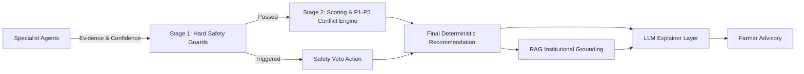
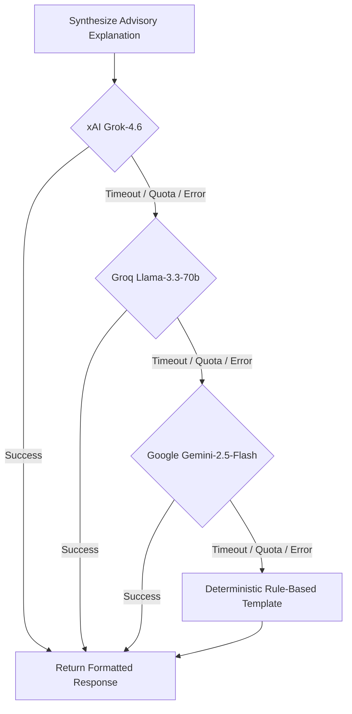

# AgriMind — AI & Multi-Agent Orchestration

## 1. Orchestration Philosophy: Separation of Decision from Explanation
AgriMind enforces an architectural invariant: **The decision is computed by deterministic algorithms and safety guards, never by an LLM.**



This prevents hallucinations from producing hazardous advice (e.g. recommending toxic chemical mixes or spraying fertilizer immediately prior to a monsoon cloudburst).

---

## 2. LangGraph State Machine Architecture (`orchestrator/graph.py`)

AgriMind coordinates agents using a compiled `LangGraph` state graph.

### 2.1. State Carrier: `AdvisoryState` (`orchestrator/state.py`)
`AdvisoryState` is a Pydantic-compatible dataclass that flows through all nodes:
```python
class AdvisoryState:
    run_id: str
    crop: str
    growth_stage: str
    lat: float
    lon: float
    location_name: str
    soil_type: str
    n: float; p: float; k: float
    weather: WeatherData
    soil: SoilData
    disease: DiseaseData
    market: MarketData
    advisory: PreliminaryAdvisoryData
    conflicts: list[dict]
    execution_trace: list[str]
    final_recommendation: str
    confidence: float
    decision_stability_score: float
    stability_level: str
    re_evaluation_trigger: str
    stage1_override: bool
```

### 2.2. Graph Nodes & Execution Pipeline
1. `node_weather`: Invokes `WeatherAgent.run()`, ingesting Open-Meteo forecasts.
2. `node_soil`: Invokes `SoilAgent.run()`, evaluating nutrient targets.
3. `node_disease`: Invokes `DiseaseAgent.run()`, processing leaf image if supplied.
4. `node_market`: Invokes `MarketAgent.run()`, computing commodity momentum.
5. `node_advisory`: Computes preliminary heuristic action scores.
6. `node_decision`: Evaluates Stage 1 Hard Safety Guards and Stage 2 P1–P5 Conflict Arbitration.
7. `node_rag`: Queries `KnowledgeRetriever` against the 2025 ICAR Kharif chunk repository.
8. `node_llm`: Formulates human-readable explanation using the multi-provider waterfall.

---

## 3. Two-Stage Decision Hierarchy (`decision/`)

### 3.1. Stage 1: Deterministic Hard Safety Guards (`decision/safety_guard.py`)
Hard Safety Guards operate as non-negotiable short-circuits. If any guard triggers, Stage-2 scoring is bypassed and an immediate safety veto is enforced.

- **Guard A (Rainfall Safety Veto):**
  $$\text{Condition: } (\text{PrecipProb} \ge 0.70 \lor \text{PrecipSum} \ge 5.0\text{ mm}) \land \text{ProposedAction} \in \{\text{apply\_fertilizer}, \text{spray}\}$$
  Enforces action: `DELAY`. Prevents fertilizer leaching and pesticide runoff.
- **Guard B (Severe Disease Outbreak):**
  $$\text{Condition: } \text{DiseaseConfidence} \ge 0.60 \land \text{Severity} == \text{"high"}$$
  Enforces action: `TREAT_DISEASE` / `ISOLATE_CROP`. Overrides vegetative fertilization.
- **Guard C (Excess Moisture / Waterlogging):**
  $$\text{Condition: } \text{SoilMoisture} > 80\% \lor \text{IrrigationCondition} == \text{"delay"}$$
  Enforces action: `DELAY_IRRIGATION` / `DRAIN_FIELD`.
- **Guard D (Crop-Disease Mismatch):**
  Blocks misclassification across plant families (e.g. tomato leaf mold predicted on rice paddy).
- **Guard E (Thermal Stress Shock):**
  Blocks transplanting and high-potency chemical spraying when temperature $> 38^\circ\text{C}$.
- **Guard F (Pre-Harvest Interval Withholding):**
  Bans chemical application when crop is within 14 days of harvest.

### 3.2. Stage 2: Scoring & P1–P5 Conflict Resolution (`decision/rules.py`)
When no Stage-1 guard triggers, competing actions are scored using multi-attribute utility theory:
$$S(a) = w_{soil} S_{soil}(a) + w_{weather} S_{weather}(a) + w_{market} S_{market}(a)$$

Contradictory agent signals are adjudicated according to the strict priority tiers:

| Priority Tier | Domain | Conflict Condition | Resolution Policy |
| :--- | :--- | :--- | :--- |
| **P1** | Weather vs All | Weather hazard vs yield optimization | Weather veto wins (`DELAY`) |
| **P2** | Disease vs Soil | Pathogen pressure vs fertilizer application | Disease treatment wins (`TREAT`) |
| **P3** | Soil Deficiency | Extreme deficiency vs routine maintenance | Corrective fertilizer wins (`APPLY`) |
| **P4** | Growth Stage | Stage limitations vs high chemical dosage | Phenological constraint wins (`SCALE_DOWN`) |
| **P5** | Market Trends | Indecisive agronomic choice | Market momentum serves as tie-breaker |

---

## 4. Decision Stability Score (DSS) (`decision/scoring.py`)

AgriMind quantifies the resilience of its advice using the Decision Stability Score:

$$\text{DSS} = 1.0 - \left(w_r \cdot R_{rain} + w_c \cdot (1 - C_{action}) + w_k \cdot K_{conflicts}\right)$$
Where:
- $w_r = 0.40$ (Rainfall risk weight)
- $w_c = 0.30$ (Confidence deficit weight)
- $w_k = 0.30$ (Conflict penalty weight)
- $K_{conflicts} = \min\left(1.0, 0.25 \times \text{Number of Active Conflicts}\right)$

### Stability Tiers & Re-Evaluation Guidance:
- $\text{DSS} \ge 0.75 \implies \mathbf{HIGH}$: "High decision stability. Re-evaluate during regular crop growth monitoring."
- $0.50 \le \text{DSS} < 0.75 \implies \mathbf{MODERATE}$: "Moderate stability. Monitor changing weather conditions within 48 hours."
- $\text{DSS} < 0.50 \implies \mathbf{LOW}$: "Low stability. Conflicting environmental indicators. Verify local field drainage and re-evaluate in 24 hours."

---

## 5. Multi-Provider LLM Router (`llm/explainer.py`)

The explanation engine implements zero-downtime multi-provider fallback:



1. **System Prompt Constraints:**
   - Adhere strictly to the deterministic recommendation.
   - Do not hallucinate chemical products.
   - Explicitly articulate weather risks and nutrient targets.
2. **Deterministic Fallback:**
   Even if the server is offline or all external LLM API quotas are exhausted, AgriMind produces clear, professional agronomic advice with zero downtime.
