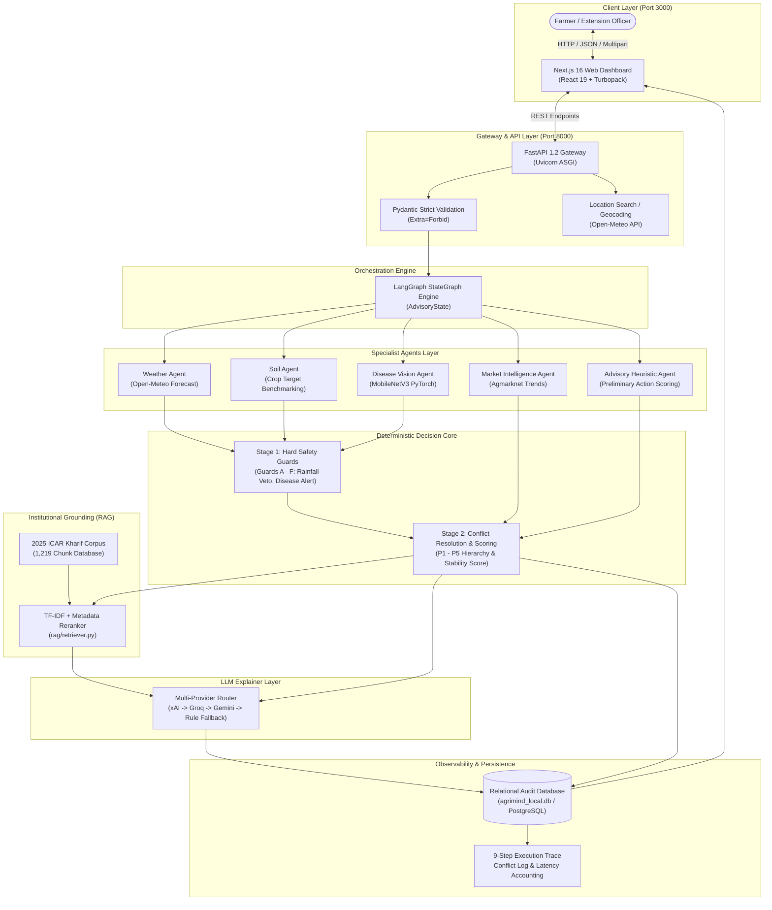

# AgriMind — System Architecture

## 1. High-Level Architectural Pattern
AgriMind follows an **Evidence-First Multi-Agent Architecture with Deterministic Safety Core**. 

Unlike conventional LLM-based autonomous systems where agents execute free-form prompts and actions, AgriMind guarantees safety and regulatory compliance through strict domain decoupling:
- **Agents are Evidence Gatherers:** Specialist agents observe data sources, compute domain-specific features, and assign confidence scores.
- **Decision Engine is Purely Deterministic:** The resolution of conflicting recommendations and the selection of actions are governed by deterministic rule sets and mathematical score matrices.
- **LLM is Strictly Explanatory:** Generative language models are decoupled from decision logic and utilized solely to formulate human-readable agronomic explanations.

---

## 2. Architecture Diagram

---

## 3. Core Architectural Subsystems

### 3.1. Client Layer (Next.js 16)
- **Framework:** Next.js 16.3.4 running with Turbopack for sub-second hot reloading.
- **Component Architecture:** Pure React 19 functional components with TypeScript typing.
- **Features:**
  - Dynamic geocoding location selector with latitude/longitude resolution.
  - Crop registry browser covering 32 verified crops and phenological growth stages.
  - Multipart leaf photo uploader for mobile field diagnosis.
  - Decision stability indicator badge (HIGH / MODERATE / LOW).
  - ICAR reference citations drawer and interactive farmer feedback loop.

### 3.2. Gateway & API Layer (FastAPI)
- **Framework:** FastAPI 0.115+ running on Uvicorn with standard workers.
- **Validation:** Strict Pydantic models with `model_config = ConfigDict(extra="forbid")` preventing untrusted field injection.
- **Endpoints:**
  - `GET /health`: Liveness and readiness probe.
  - `GET /api/crops`: Registry of supported crops, aliases, and growth stages.
  - `GET /api/location/search`: Open-Meteo geocoding search for Indian villages and mandis.
  - `POST /api/advisory`: JSON advisory pipeline invocation.
  - `POST /api/advisory/upload`: Multipart image upload and advisory pipeline invocation.
  - `GET /api/runs/{run_id}`: Relational observability query.
  - `POST /api/feedback`: Farmer feedback and field outcome ledgering.

### 3.3. Orchestration Engine (LangGraph)
- **Engine:** LangGraph 1.2 StateGraph coordinating state transitions.
- **State Carrier:** `AdvisoryState` dataclass preserving:
  - Input parameters (crop, stage, soil NPK, geographic coordinates).
  - Domain outputs (`weather`, `soil`, `disease`, `market`, `advisory`).
  - Active conflicts and applied resolution policies.
  - Stage-1 override flags and Stage-2 final action.
  - Decision Stability Score (DSS) and re-evaluation triggers.
  - Structured 9-step execution trace.

### 3.4. Specialist Agents Layer
1. **Weather Agent (`agents/weather_agent.py`):** Ingests live meteorological data from Open-Meteo (hourly precipitation probability, cumulative rainfall, temperature extremes). Computes rainfall and temperature risk metrics.
2. **Soil Agent (`agents/soil_agent.py`):** Benchmarks user-provided soil NPK values against scientific crop target standards across 32 crops and 5 growth stages.
3. **Disease Agent (`agents/disease_agent.py`):** Runs on-device vision inference using PyTorch MobileNetV3. Employs a 60% confidence gate and PlantVillage label normalization.
4. **Market Agent (`agents/market_agent.py`):** Tracks commodity market price momentum and volatility from Agmarknet.
5. **Advisory Agent (`agents/advisory_agent.py`):** Computes preliminary action weights (`apply_fertilizer`, `delay`, `monitor`) prior to conflict resolution.

### 3.5. Deterministic Decision Core (`decision/`)
- **Stage 1 (Hard Safety Guards):** Evaluates non-negotiable safety constraints (e.g., Rainfall Veto Guard A, Disease Outbreak Guard B).
- **Stage 2 (Scoring & Conflict Resolution):** Evaluates multi-agent trade-offs according to strict priority tiers (P1 to P5) and computes the Decision Stability Score (DSS).

### 3.6. Grounding Layer (`rag/`)
- **Corpus:** 2025 ICAR Kharif agro-advisories ingested into clean chunk structures (`knowledge/icar_chunks.json`).
- **Retrieval:** Hybrid TF-IDF candidate selection combined with domain metadata filtering (crop matching, growth stage filtering, disease tagging).

### 3.7. LLM Explainer Layer (`llm/`)
- Multi-provider fallback chain: **xAI (Grok-4.6)** -> **Groq (Llama-3.3-70b)** -> **Google Gemini (Gemini-2.5-Flash)** -> **Deterministic Rule Template**.
- The LLM can never alter the recommendation computed by the deterministic core; it merely articulates the rationale.

### 3.8. Observability & Persistence (`observability/`)
- Relational storage (`agrimind_local.db` or PostgreSQL) across 5 core tables (`runs`, `agent_logs`, `decisions`, `conflicts`, `feedback`).
- Complete latency breakdown per agent and end-to-end pipeline.
