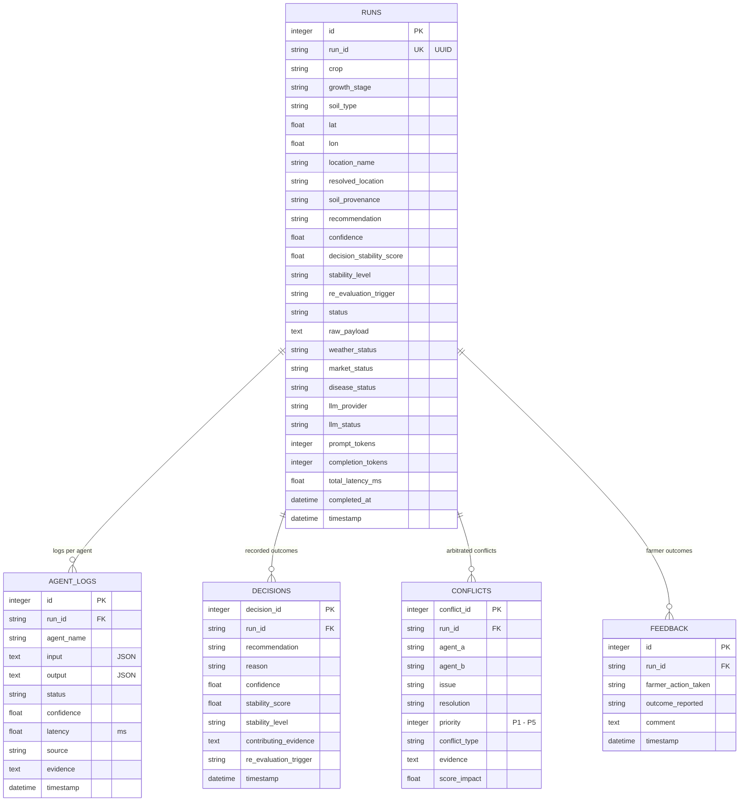

# AgriMind — Database & Persistence Documentation

AgriMind implements a relational observability and audit trail persistence engine via SQLAlchemy 2.0. By default, it operates on a local SQLite database (`agrimind_local.db`), and seamlessly connects to PostgreSQL (e.g. Supabase / AWS RDS) via the `DATABASE_URL` environment variable.

---

## 1. Entity-Relationship (ER) Architecture



---

## 2. Table Specifications & Schemas

### 2.1. Table: `runs` (`RunRecord`)
Serves as the root master ledger entry for every advisory execution.

| Column | Type | Nullable | Description |
| :--- | :--- | :--- | :--- |
| `id` | `INTEGER` | No (PK) | Auto-incrementing internal identifier. |
| `run_id` | `VARCHAR` | No (Indexed, Unique) | Global UUID assigned during request ingestion. |
| `crop` | `VARCHAR` | Yes | Target crop normalized identifier. |
| `growth_stage` | `VARCHAR` | Yes | Crop phenological development stage. |
| `soil_type` | `VARCHAR` | Yes | Soil texture classification. |
| `lat`, `lon` | `FLOAT` | Yes | Geographic GPS coordinates of the farm. |
| `location_name` | `VARCHAR` | Yes | User-supplied location description. |
| `resolved_location` | `VARCHAR` | Yes | Canonical geocoded address string. |
| `soil_provenance` | `VARCHAR` | Yes | `"MEASURED"` or `"ESTIMATED"`. |
| `recommendation` | `VARCHAR` | Yes | Final action (e.g. `"delay"`, `"apply_fertilizer"`). |
| `confidence` | `FLOAT` | Yes | Decision confidence metric $[0.0, 1.0]$. |
| `decision_stability_score` | `FLOAT` | Yes | Calculated Decision Stability Score $[0.0, 1.0]$. |
| `stability_level` | `VARCHAR` | Yes | `"HIGH"`, `"MODERATE"`, or `"LOW"`. |
| `re_evaluation_trigger` | `VARCHAR` | Yes | Recommended re-testing trigger instruction. |
| `status` | `VARCHAR` | No | `"completed"` or `"failed"`. |
| `raw_payload` | `TEXT` | Yes | Sanitized JSON representation of client inputs. |
| `weather_status` | `VARCHAR` | No | `"AVAILABLE"` or `"DEGRADED"`. |
| `market_status` | `VARCHAR` | No | `"AVAILABLE"` or `"UNAVAILABLE"`. |
| `disease_status` | `VARCHAR` | No | `"AVAILABLE"`, `"CONFIRMED"`, or `"NOT_SUPPLIED"`. |
| `llm_provider` | `VARCHAR` | Yes | LLM used (`"xai"`, `"groq"`, `"gemini"`, or `"deterministic"`). |
| `prompt_tokens` | `INTEGER` | Yes | Input token count consumed. |
| `completion_tokens` | `INTEGER` | Yes | Output tokens generated. |
| `total_latency_ms` | `FLOAT` | Yes | Wall-clock execution time in milliseconds. |
| `timestamp` | `DATETIME` | No | UTC timestamp of request. |

### 2.2. Table: `agent_logs` (`AgentLog`)
Stores individual execution traces, latency, and payloads per specialist agent.

| Column | Type | Nullable | Description |
| :--- | :--- | :--- | :--- |
| `id` | `INTEGER` | No (PK) | Primary key. |
| `run_id` | `VARCHAR` | No (Indexed) | Parent run foreign key reference. |
| `agent_name` | `VARCHAR` | No | `"weather"`, `"soil"`, `"disease"`, `"market"`, `"advisory"`. |
| `input` | `TEXT` | Yes | JSON string of inputs passed to the agent. |
| `output` | `TEXT` | Yes | JSON string of structured output from agent. |
| `status` | `VARCHAR` | Yes | `"ok"`, `"degraded"`, `"unavailable"`, `"no_input"`. |
| `confidence` | `FLOAT` | Yes | Agent self-reported confidence. |
| `latency` | `FLOAT` | Yes | Execution duration for this agent in milliseconds. |
| `source` | `VARCHAR` | Yes | Data provenance (`"open_meteo"`, `"mobilenet_v3"`, etc.). |
| `timestamp` | `DATETIME` | No | UTC timestamp. |

### 2.3. Table: `decisions` (`Decision`)
Records formal recommendation outputs and reasoning trails.

| Column | Type | Nullable | Description |
| :--- | :--- | :--- | :--- |
| `decision_id` | `INTEGER` | No (PK) | Primary key. |
| `run_id` | `VARCHAR` | No (Indexed) | Parent run reference. |
| `recommendation` | `VARCHAR` | Yes | Chosen action code. |
| `reason` | `VARCHAR` | Yes | Deterministic policy rationale. |
| `confidence` | `FLOAT` | Yes | Final score confidence. |
| `stability_score` | `FLOAT` | Yes | Decision Stability Score. |
| `stability_level` | `VARCHAR` | Yes | Stability classification category. |
| `re_evaluation_trigger` | `VARCHAR` | Yes | Farmer guidance for subsequent checks. |
| `timestamp` | `DATETIME` | No | UTC timestamp. |

### 2.4. Table: `conflicts` (`Conflict`)
Records inter-agent contradictions and arbitration policies.

| Column | Type | Nullable | Description |
| :--- | :--- | :--- | :--- |
| `conflict_id` | `INTEGER` | No (PK) | Primary key. |
| `run_id` | `VARCHAR` | No (Indexed) | Parent run reference. |
| `agent_a` | `VARCHAR` | Yes | Primary conflicting agent (e.g. `"weather"`). |
| `agent_b` | `VARCHAR` | Yes | Secondary conflicting agent (e.g. `"soil"`). |
| `issue` | `VARCHAR` | Yes | Description of the contradictory signals. |
| `resolution` | `VARCHAR` | Yes | Final resolution action enforced. |
| `priority` | `INTEGER` | Yes | Priority tier applied ($1$ to $5$). |
| `conflict_type` | `VARCHAR` | Yes | `"OVERRIDE_HARD_SAFETY"` or `"SCORING_TRADE_OFF"`. |
| `score_impact` | `FLOAT` | Yes | DSS penalty applied due to the conflict. |

### 2.5. Table: `feedback` (`Feedback`)
Farmer outcome validation ledger.

| Column | Type | Nullable | Description |
| :--- | :--- | :--- | :--- |
| `id` | `INTEGER` | No (PK) | Primary key. |
| `run_id` | `VARCHAR` | No (Indexed) | Run being evaluated. |
| `farmer_action_taken` | `VARCHAR` | No | What the farmer actually did in the field. |
| `outcome_reported` | `VARCHAR` | Yes | Agronomic outcome observed (e.g. harvest, runoff). |
| `comment` | `TEXT` | Yes | Qualitative farmer notes. |
| `timestamp` | `DATETIME` | No | UTC timestamp. |

---

## 3. Database Initialization & Migration
Database tables are initialized automatically during application startup via FastAPI lifespan hook in `api/main.py`:
```python
@asynccontextmanager
async def lifespan(_app: FastAPI):
    obs.init_db()  # Creates all tables if they do not exist
    yield
```
For production PostgreSQL deployments, executing `observability/schema.sql` provisions the corresponding PostgreSQL tables and row-level security (RLS) policies.
