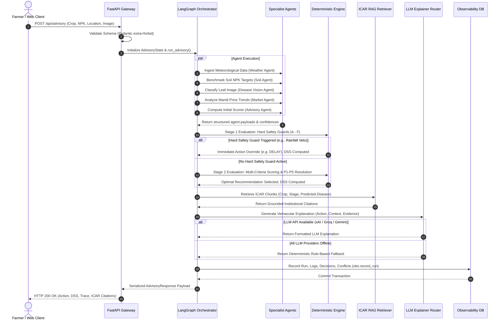

# AgriMind — System Workflow

## 1. End-to-End Execution Sequence
AgriMind executes an end-to-end advisory request across seven distinct phases. The entire pipeline completes in under 2 seconds during live operations.

---

## 2. Phase-by-Phase Technical Walkthrough

### Phase 1: Request Ingestion & Geocoding Resolution
1. Client submits either JSON payload (`POST /api/advisory`) or multipart form with leaf image (`POST /api/advisory/upload`).
2. FastAPI validates parameters:
   - Latitude must be between `-90.0` and `90.0`.
   - Longitude must be between `-180.0` and `180.0`.
   - Crop name is normalized against `data_sources/crops.py` registry (e.g., `"paddy"` -> `"rice"`).
   - If location name is supplied without coordinates, `data_sources/geocoding.py` resolves coordinates via Open-Meteo Geocoding API.
3. A unique UUID `run_id` is provisioned.

### Phase 2: Multi-Agent Parallel Execution
The orchestrator dispatches execution to the five domain agents:
- **Weather Agent:** Queries Open-Meteo API for 7-day forecast. Evaluates rainfall risk $R_{rain}$ and temperature anomaly $R_{temp}$.
- **Soil Agent:** Evaluates supplied Nitrogen ($N$), Phosphorus ($P$), Potassium ($K$) against growth-stage benchmarks:
  $$	ext{Deficiency} = \max\left(0, rac{	ext{Target} - 	ext{Supplied}}{	ext{Target}}
ight)$$
- **Disease Vision Agent:** If a leaf image was uploaded, it is preprocessed (RGB normalization, $224 	imes 224$) and passed to MobileNetV3. If predicted confidence $< 0.60$, the result is gated and flagged as uncertain.
- **Market Agent:** Calculates 7-day price momentum and volatility from Agmarknet mandi feeds.
- **Advisory Agent:** Formulates initial action scores based on agronomic heuristics.

### Phase 3: Stage 1 — Hard Safety Guards
The engine evaluates non-negotiable safety rules in strict precedence:
- **Guard A (Rainfall Safety Veto):** If predicted precipitation probability $> 70\%$ or expected rainfall $> 5	ext{ mm}$ within 48h, chemical fertilizer application is **vetoed** (`DELAY`). Fertilizer cannot be applied.
- **Guard B (Severe Disease Outbreak):** If active disease confidence $\ge 0.60$ and severity is high, disease treatment takes precedence over standard vegetative fertilization (`TREAT_DISEASE`).
- **Guard C (Extreme Moisture/Saturated Soil):** If soil moisture $> 80\%$, irrigation is forbidden.
- **Guard D (Crop-Disease Incompatibility Gate):** Prevents misclassifications across different plant species.
- **Guard E (Drought Emergency Veto):** If drought stress is acute, pruning and fertilization are halted.
- **Guard F (Harvest Proximity Chemical Withholding):** Blocks chemical spraying if harvest is within the pre-harvest interval (PHI).

### Phase 4: Stage 2 — Scoring & P1–P5 Conflict Resolution
If no Stage-1 guard triggers an immediate veto, Stage-2 computes weighted action scores:
$$S(	ext{action}) = w_{soil} \cdot S_{soil} + w_{weather} \cdot S_{weather} + w_{market} \cdot S_{market}$$
When competing agents propose contradictory actions, the conflict is adjudicated using the P1–P5 priority hierarchy:
- **Priority 1 (Weather Safety):** Meteorological safety overrides all yield optimization actions.
- **Priority 2 (Biosecurity / Phytosanitary):** Disease mitigation overrides nutritional optimization.
- **Priority 3 (Soil Deficiency):** Verified nutrient deficits override general maintenance schedules.
- **Priority 4 (Growth Stage Constraints):** Phenological stage limits chemical dosage.
- **Priority 5 (Market Intelligence):** Harvest timing and market price signals serve as tie-breakers between equally weighted agronomic actions.

### Phase 5: Decision Stability Score (DSS) Calculation
The engine evaluates the resilience of the recommendation:
$$	ext{DSS} = 1.0 - \left(0.4 \cdot 	ext{RainfallRisk} + 0.3 \cdot (1 - 	ext{Confidence}) + 0.3 \cdot 	ext{ConflictPenalty}
ight)$$
- $	ext{DSS} \ge 0.75$: **HIGH** stability.
- $0.50 \le 	ext{DSS} < 0.75$: **MODERATE** stability.
- $	ext{DSS} < 0.50$: **LOW** stability (triggers immediate farmer re-evaluation advice).

### Phase 6: Institutional Knowledge Grounding (RAG)
`rag/retriever.py` searches the 2025 ICAR Kharif chunk database using:
- Crop filter: e.g., `"rice"`
- Growth stage filter: e.g., `"vegetative"`
- Disease query: e.g., `"blast"` or `"brown spot"`
Returns exact ICAR advisory excerpts with page numbers and safety instructions.

### Phase 7: Multi-Provider LLM Explanation & Observability
1. The deterministic recommendation, agent evidence, and ICAR citations are passed to `llm/explainer.py`.
2. Provider waterfall:
   - xAI Grok-4.6 $	o$ Groq Llama-3.3-70b $	o$ Google Gemini-2.5-Flash $	o$ Deterministic Template.
3. The explanation, decision matrix, conflict logs, and latency timings are written to `agrimind_local.db` via `observability/database.py`.
4. Response is returned to the client.
